# HƯỚNG DẪN GIÁO VIÊN DÙNG LMS JUNIOR

> **TÀI LIỆU NỘI BỘ – DÀNH CHO GIÁO VIÊN VÀ CÁC PHÒNG BAN, KHÔNG GỬI LINK CHO PHỤ HUYNH.**
>
> - **Phạm vi:** Việc giáo viên làm trên LMS [lmskid.cybersoft.edu.vn](https://lmskid.cybersoft.edu.vn) trước, trong, sau buổi dạy và thông tin cá nhân.
> - **Đối tượng:** Giảng viên chính và mentor.
> - **Cập nhật:** 11/11/2026. Ảnh chụp từ LMS thật, dữ liệu lớp demo.

**Nội dung:** 1. Trước buổi dạy · 2. Trong buổi dạy · 3. Sau buổi dạy · 4. Cuối khóa và cá nhân · Các mốc thời gian

Đăng nhập lần đầu: Admin gửi tên đăng nhập và mật khẩu mặc định sau khi tạo tài khoản; đổi mật khẩu ngay ở Tài khoản của tôi. Giảng viên chính và mentor dùng chung các màn hình dưới đây. Mentor điểm danh được; ghi chú từng em là việc riêng của mỗi người; mức 5 năng lực do mentor chấm là mức đề xuất để giảng viên chốt.

---

## 1. Trước buổi dạy

### Bàn làm việc và thông báo

1. Đăng nhập; LMS mở Bàn làm việc giảng dạy.
2. Lớp của tôi: tiến độ, chuyên cần, bài chờ chấm, buổi tới. Bấm Vào lớp để mở lớp.
3. Buổi còn thiếu điểm danh / nhật ký: làm hết trước buổi mới.
4. Chuông thông báo: Chuẩn bị buổi, Chưa điểm danh, Quá hạn.

[Mở trên LMS: Bàn làm việc](https://lmskid.cybersoft.edu.vn/giang-day)

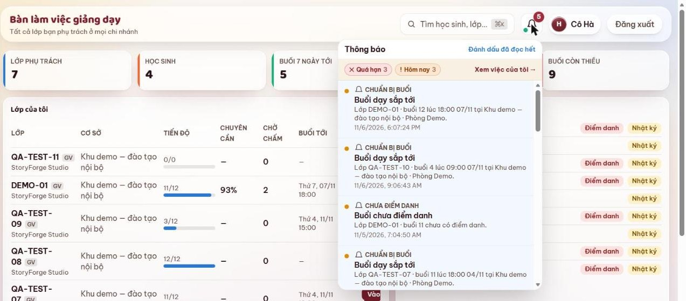

### Tài nguyên buổi

1. Vào lớp → Tài nguyên buổi → chọn buổi.
2. Tài nguyên CyberSoft chỉ xem trên LMS: không tải về, không sửa.
3. Thấy lỗi hoặc cần sửa: ghi vào ô Phản hồi → Gửi phản hồi.
4. Có mặt trước giờ học 15 phút; kiểm máy chiếu, mạng, phần mềm.

[Mở trên LMS: Tài nguyên buổi](https://lmskid.cybersoft.edu.vn/giang-day/lop?tab=taiNguyen)

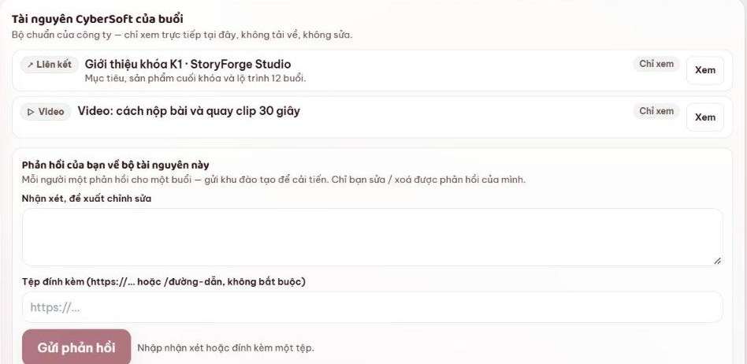

---

## 2. Trong buổi dạy

### Khởi động lớp

1. Menu Khởi động lớp: mở bài khởi động của buổi hôm nay.
2. Theo dõi số em đã khởi động; nhắc em “chưa làm”.
3. AI gợi ý nhận xét: đọc lại, sửa đúng rồi mới dùng.
4. Thêm mới: hoạt động khởi động riêng của thầy cô.

[Mở trên LMS: Khởi động](https://lmskid.cybersoft.edu.vn/giang-day/lop?tab=khoiDong)

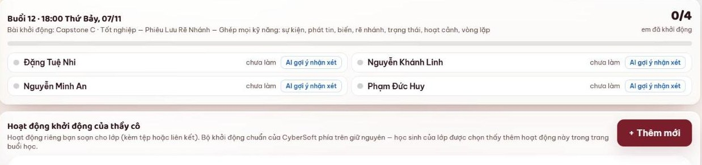

### Điểm danh

1. Chọn buổi hôm nay. Mặc định cả lớp Có mặt; chỉ chạm em Đi muộn, Vắng có phép hoặc Vắng.
2. Bấm Lưu điểm danh. Buổi có điểm danh mới được Giáo vụ xác nhận công dạy.
3. Giảng viên, mentor: từ 5 phút trước giờ học đến 24 giờ sau buổi. Giáo vụ: mọi lúc.
4. Vào lớp sau 15 phút là Đi muộn; Vắng có phép khi phụ huynh đã báo theo Nội quy.

[Mở trên LMS: Điểm danh](https://lmskid.cybersoft.edu.vn/giang-day/lop?tab=diemDanh)

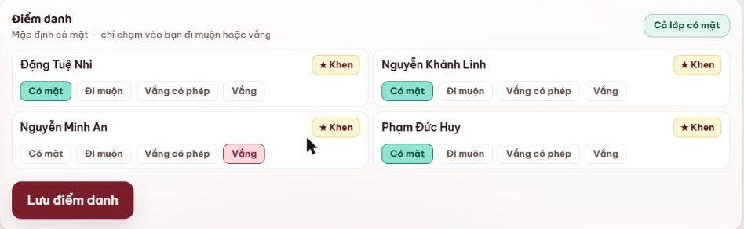

### Giao bài tập

1. Nhập tiêu đề, mô tả; chọn công cụ: Scratch, Viết code, Bảng nhóm, Nộp liên kết.
2. Chọn hạn nộp và buổi gắn bài; giao được cho nhiều lớp.
3. Bật “Bắt buộc ba bằng chứng” (bản nháp, nhật ký AI, clip giải thích) để xét Dấu Tự Làm.
4. Bấm Giao bài. Bảng Bài đã giao cho biết số em đã nộp, đã chấm.

[Mở trên LMS: Giao bài tập](https://lmskid.cybersoft.edu.vn/giang-day/lop?tab=baiTap)

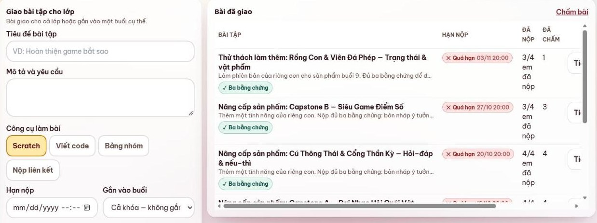

---

## 3. Sau buổi dạy

### Nhật ký buổi

1. Vào lớp → Nhật ký buổi → chọn buổi vừa dạy.
2. Ghi lớp học gì, hoạt động nổi bật, sản phẩm các con làm.
3. Dán đường dẫn ảnh hoặc clip → Đăng nhật ký.
4. Đăng ngay khi tan lớp.

[Mở trên LMS: Nhật ký buổi](https://lmskid.cybersoft.edu.vn/giang-day/lop?tab=nhatKy)

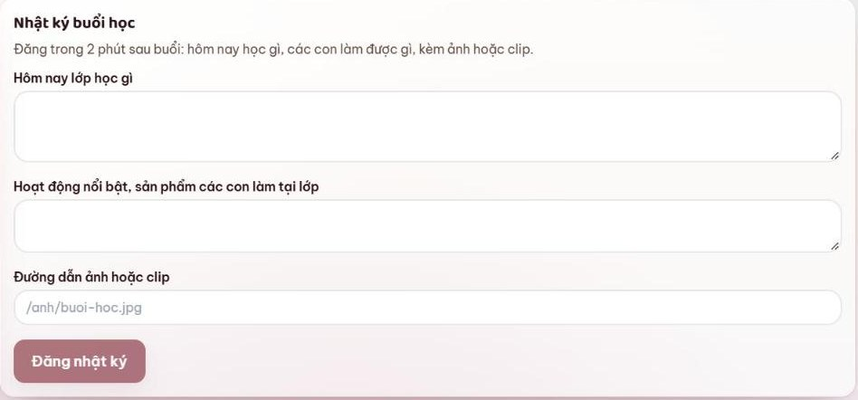

### Nhận xét buổi học

1. Mỗi em hai ô: Lời động viên (học sinh, phụ huynh thấy) và Góp ý riêng (chỉ phụ huynh thấy).
2. Khen em nổi bật. Lưu lại là cập nhật, không tạo trùng.
3. Hạn 48 giờ sau buổi, đủ hai kênh: LMS và nhóm Zalo lớp (Mẫu 8).
4. Zalo lớp không nêu chi tiết từng em, không đăng sau 22 giờ.

[Mở trên LMS: Nhận xét](https://lmskid.cybersoft.edu.vn/giang-day/lop?tab=nhanXet)

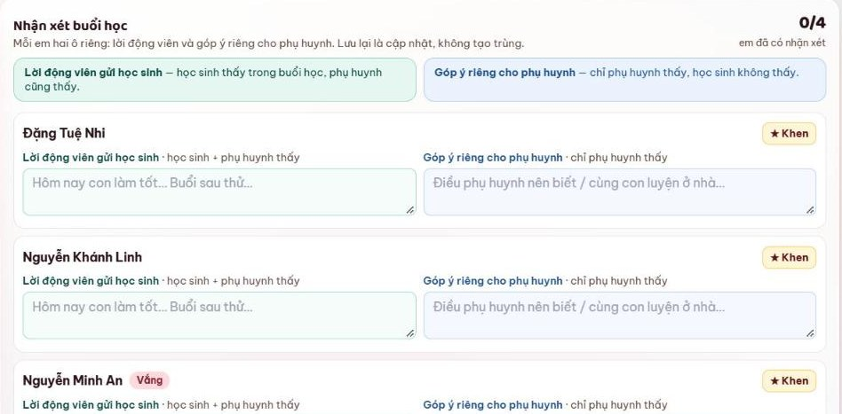

### Ghi chú từng em

1. Bắt buộc: mỗi em một ghi chú mỗi buổi. Giảng viên và mentor ghi riêng.
2. Ghi chú nội bộ: học sinh, phụ huynh không thấy. Phần gửi ba mẹ ở ô dưới, qua Giáo vụ duyệt.
3. Gợi ý từ AI: đọc lại, sửa đúng rồi mới lưu.
4. Hạn 48 giờ sau buổi. Ctrl + Enter: lưu và sang em kế tiếp.

[Mở trên LMS: Ghi chú từng em](https://lmskid.cybersoft.edu.vn/giang-day/lop?tab=ghiChu)

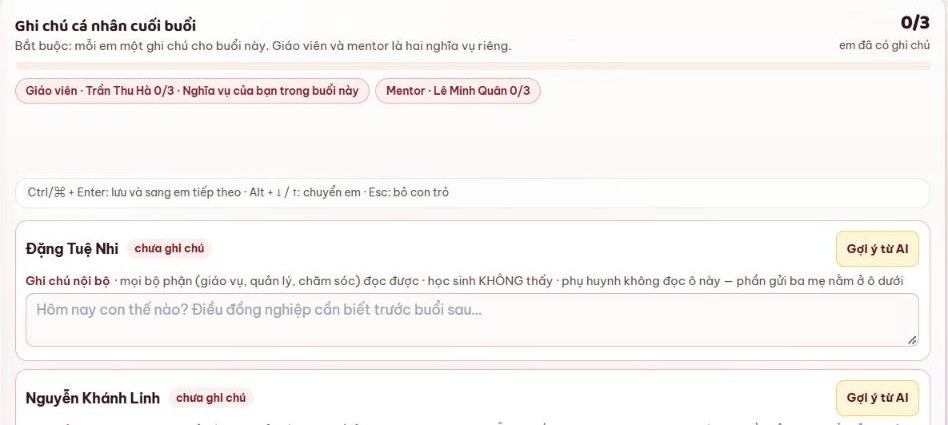

### Chấm bài và 5 năng lực

1. Xem 3 bằng chứng → chọn Mức (Cần giúp, Đạt, Tốt, Xuất sắc) → viết Nhận xét cho con → Lưu chấm.
2. Đóng Dấu Tự Làm khi bài đủ 3 bằng chứng và em tự làm.
3. Hạn chấm: 7 ngày sau khi em nộp, trước buổi học tiếp theo; ưu tiên bài nộp sớm.
4. 5 năng lực: giảng viên chốt mức; mức mentor chấm là đề xuất.

[Mở trên LMS: Chấm bài](https://lmskid.cybersoft.edu.vn/giang-day/lop?tab=chamBai) · [5 năng lực](https://lmskid.cybersoft.edu.vn/giang-day/lop?tab=nangLuc)

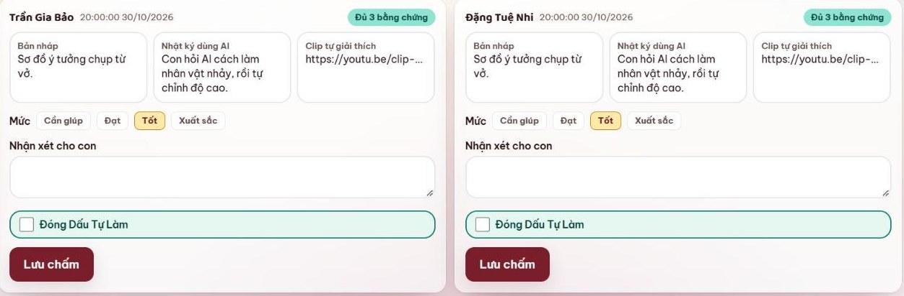

---

## 4. Cuối khóa và cá nhân

### Dự án cuối khóa và tổng kết

1. Dự án cuối khóa có 3 mốc: Ý tưởng, Bản nháp chạy thử, Final Demo. Bấm ô của em để xem và duyệt.
2. Nhắc em chưa nộp trước từng mốc.
3. Tổng kết: đủ điều kiện chứng chỉ khi chuyên cần từ 70% và đã nộp mốc dự án cuối.
4. Sản phẩm đưa ra khu công khai cần phụ huynh đồng ý.

[Mở trên LMS: Dự án cuối khóa](https://lmskid.cybersoft.edu.vn/giang-day/lop?tab=duAn) · [Tổng kết](https://lmskid.cybersoft.edu.vn/giang-day/lop?tab=tongKet)

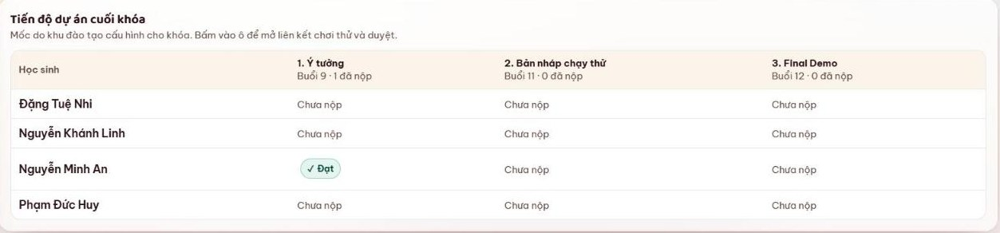

### Tài khoản, công dạy và báo nghỉ

1. Tài khoản của tôi: kiểm họ tên, email, số điện thoại → Lưu thông tin.
2. Lần đầu đăng nhập bằng mật khẩu mặc định: đổi mật khẩu ngay; không cho người khác dùng.
3. Công của tôi: kiểm ca dạy trong tháng; sai hoặc thiếu, báo Giáo vụ.
4. Báo nghỉ: báo Đào tạo trước, Giáo vụ sau. Không gửi thông tin học sinh ra ngoài nhóm lớp.

[Mở trên LMS: Tài khoản của tôi](https://lmskid.cybersoft.edu.vn/tai-khoan-cua-toi) · [Công của tôi](https://lmskid.cybersoft.edu.vn/giang-day/cham-cong)

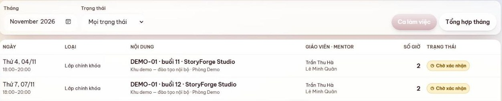

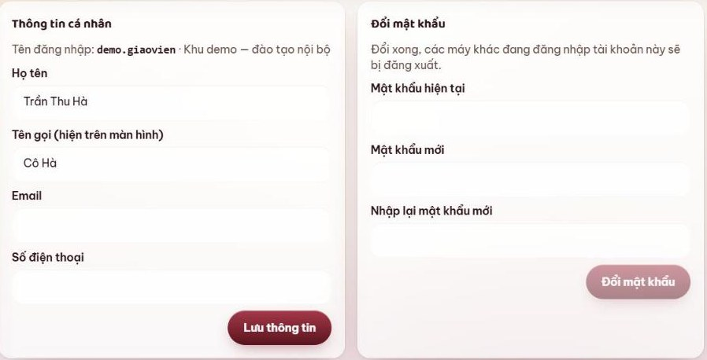

---

## Các mốc thời gian

| Việc | Thời hạn | Lưu ý |
|---|---|---|
| Báo nghỉ | Trước 3 ngày (biết trước); trước 24 giờ (ốm, việc gấp) | Báo Đào tạo trước, Giáo vụ sau |
| Có mặt tại lớp | Trước giờ học 15 phút | Kiểm máy chiếu, mạng, phần mềm |
| Điểm danh | Từ 5 phút trước giờ học đến 24 giờ sau buổi | Giáo vụ điểm danh, sửa được mọi lúc |
| Nhật ký buổi | Ngay khi tan lớp | Kèm đường dẫn ảnh hoặc clip |
| Nhận xét, ghi chú từng em | Trong 48 giờ sau buổi | Đủ LMS và Zalo lớp; không đăng Zalo sau 22 giờ |
| Chấm bài | 7 ngày sau khi em nộp, trước buổi học tiếp theo | Ưu tiên bài nộp sớm |
