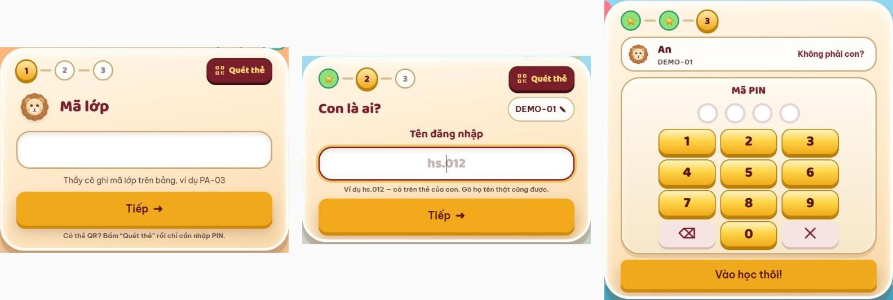
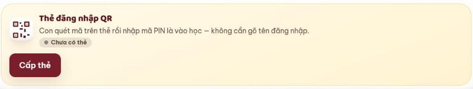
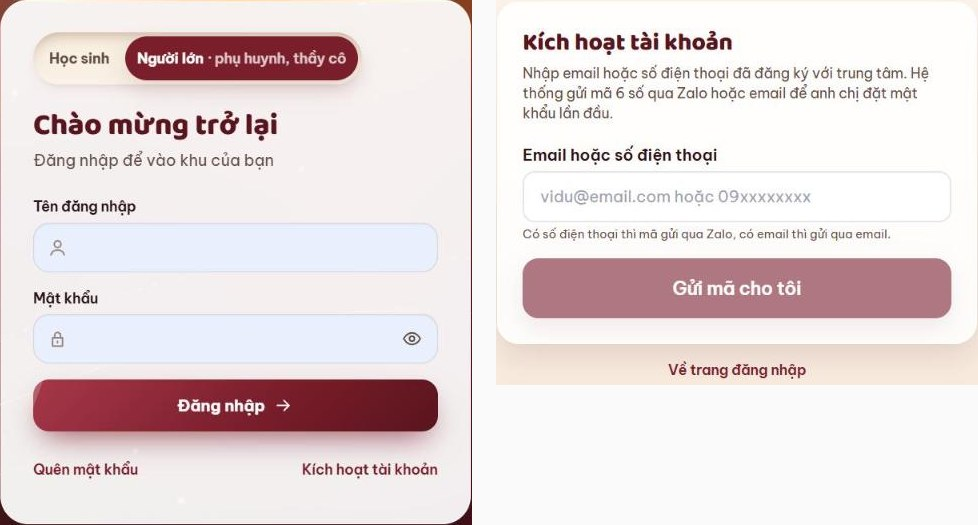
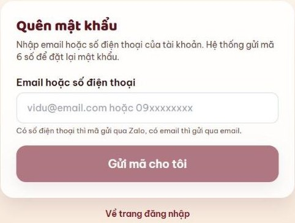

# 1. Đăng nhập, thẻ QR, quên mật khẩu

> **Cập nhật:** 12/11/2026 · [Về trang tổng quan](hoc-vien/huong-dan-lms.md)

## Học viên

1. Mở [lmskid.cybersoft.edu.vn](https://lmskid.cybersoft.edu.vn), chọn tab **Học sinh**.
2. Bước 1: nhập **Mã lớp** thầy cô ghi trên bảng (ví dụ PA-03) → **Tiếp**.
3. Bước 2 “Con là ai?”: nhập **Tên đăng nhập** có trên thẻ (ví dụ hs.012), hoặc gõ họ tên thật → **Tiếp**.
4. Bước 3: bấm **Mã PIN** 4 số → **Vào học thôi!** Có thẻ QR: bấm **Quét thẻ** rồi chỉ cần nhập mã PIN.

Con có ba cách đăng nhập:

| Cách | Dùng khi |
|---|---|
| Mã lớp + tên đăng nhập + mã PIN (tab Học sinh) | Ở lớp, khi con đã được xếp lớp |
| Thẻ đăng nhập QR + mã PIN | Ở lớp hoặc ở nhà; thẻ thay cho mã lớp và tên đăng nhập |
| Tên đăng nhập + mật khẩu (tab Người lớn) | Ở nhà |

Tên đăng nhập, mật khẩu và mã PIN của con do trung tâm cấp khi nhập học.

## Thẻ đăng nhập QR

1. Khi nhập học, trung tâm in cho phụ huynh thẻ tài khoản (tên đăng nhập, mật khẩu, mã PIN của con) và thẻ QR của con. Con chưa được xếp lớp vẫn dùng thẻ QR để vào tự luyện.
2. Cần thẻ mới: phụ huynh vào **Con của tôi** → **Thẻ đăng nhập QR** → **Cấp thẻ mới**. Mã thẻ chỉ hiện một lần lúc cấp: bấm **In thẻ** hoặc chụp lại ngay, dán vào vở hoặc cặp của con.
3. Con quét mã QR bằng máy tính bảng hoặc điện thoại, rồi nhập mã PIN. Thẻ vẫn cần PIN nên mất thẻ, người khác cũng không vào được.
4. Mất thẻ: bấm **Thu hồi thẻ**, rồi **Cấp thẻ mới**; thẻ cũ hết hiệu lực ngay. Trong lúc chờ, con đăng nhập bằng tên đăng nhập + mật khẩu.

## Phụ huynh

1. Chọn tab **Người lớn** (phụ huynh, thầy cô), nhập Tên đăng nhập và Mật khẩu → **Đăng nhập**.
2. Lần đầu dùng: bấm **Kích hoạt tài khoản**, nhập email hoặc số điện thoại đã đăng ký với trung tâm → **Gửi mã cho tôi**.
3. Nhập mã 6 số: có số điện thoại thì mã gửi qua Zalo, có email thì gửi qua email.
4. Đặt mật khẩu từ 8 ký tự trở lên.

## Quên mật khẩu, mã PIN hoặc mất thẻ

| Trường hợp | Cách làm |
|---|---|
| Phụ huynh quên mật khẩu | Bấm **Quên mật khẩu** ở tab Người lớn → nhập email hoặc số điện thoại của tài khoản → **Gửi mã cho tôi** → nhập mã 6 số → đặt mật khẩu mới. |
| Không nhận được mã 6 số, hoặc đã đổi email, số điện thoại | Báo Giáo viên hoặc Giáo vụ của lớp để cập nhật thông tin. |
| Học viên quên mã lớp hoặc tên đăng nhập | Báo Giáo viên hoặc Giáo vụ để được nhắc lại. |
| Học viên quên mã PIN | Đăng nhập bằng tên đăng nhập + mật khẩu (tab Người lớn). |
| Học viên quên mật khẩu | Đăng nhập bằng mã lớp + mã PIN, hoặc thẻ QR + mã PIN. |
| Học viên mất thẻ đăng nhập | Phụ huynh vào Con của tôi → **Thu hồi thẻ** → **Cấp thẻ mới**. Không tự làm được thì báo Giáo viên hoặc Giáo vụ; Giáo vụ thu hồi thẻ cũ và cấp thẻ mới. |

Giữ kín mật khẩu, mã PIN; không đưa thẻ đăng nhập cho người khác.

---

**Phần tiếp theo:** [2. Học theo buổi](hoc-vien/02-hoc-theo-buoi.md)
