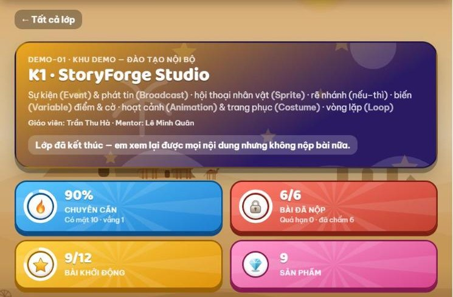
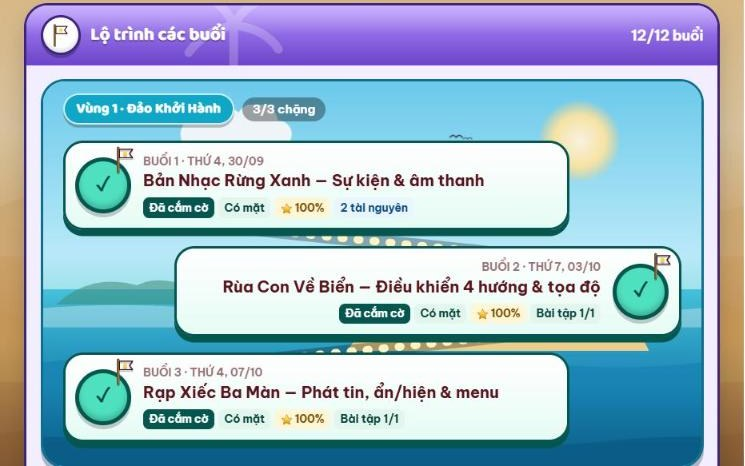
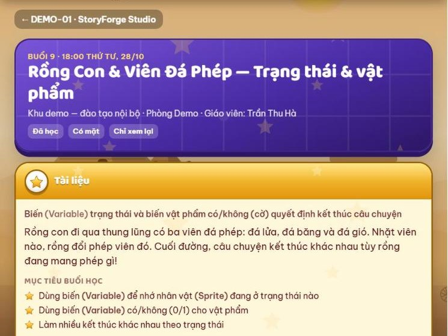
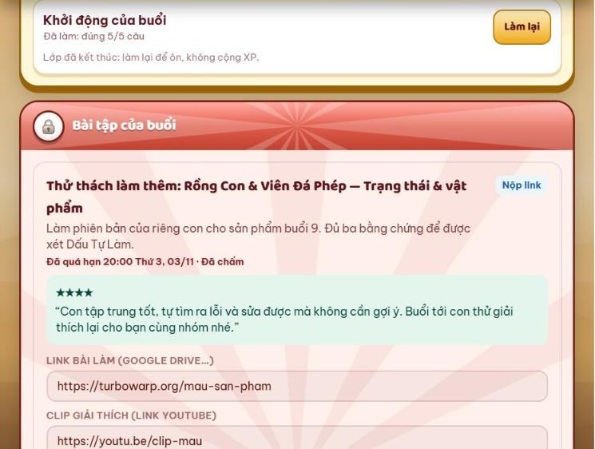

# 2. Học theo buổi

> **Cập nhật:** 12/11/2026 · [Về trang tổng quan](hoc-vien/huong-dan-lms.md)

## Lớp học và lộ trình

1. Menu **Lớp học** → chọn lớp: xem chuyên cần, số bài đã nộp, bài khởi động, sản phẩm.
2. **Lộ trình các buổi**: buổi đã học có dấu tích, kèm trạng thái có mặt, số sao và bài tập.
3. Bấm một buổi để mở trang của buổi đó.
4. Lớp đã kết thúc: xem lại được mọi nội dung, không nộp bài nữa.

[Mở trên LMS: Lớp học](https://lmskid.cybersoft.edu.vn/hoc-sinh/lop)

## Trong một buổi

1. **Trước buổi:** làm **Khởi động của buổi**.
2. **Trong buổi:** học theo **Tài liệu** và mục tiêu buổi học.
3. **Sau buổi:** mở **Bài tập của buổi** ở trang buổi học. Bấm **Mở Scratch để làm**, làm xong bấm **Lưu nháp**; quay lại trang buổi, chọn sản phẩm vừa lưu ở ô **Sản phẩm của em**, điền clip giải thích (link YouTube), bản nháp ý tưởng, nhật ký dùng AI rồi bấm **Nộp bài**. Hạn nộp ghi ở từng bài; nộp lại được.
4. Thầy cô chấm sao và nhận xét, con xem ngay trong bài. Bài đủ ba bằng chứng (bản nháp ý tưởng, nhật ký dùng AI, clip giải thích) và do con tự làm được xét **Dấu Tự Làm**.

## Dự án cuối khóa

| Mốc | Buổi (khóa 12 buổi) | Nộp |
|---|---|---|
| 1. Ý tưởng | Buổi 9 | Dán link trên trang lớp |
| 2. Bản nháp chạy thử | Buổi 11 | Link chơi thử (TurboWarp, Scratch hoặc trang web) |
| 3. Final Demo | Buổi 12 | Link chơi thử bản hoàn chỉnh |

Đủ điều kiện nhận chứng chỉ: chuyên cần từ 70% và đã nộp mốc dự án cuối.

---

**Phần tiếp theo:** [3. Tự luyện](hoc-vien/03-tu-luyen.md)
