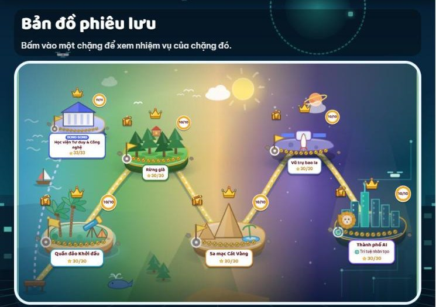
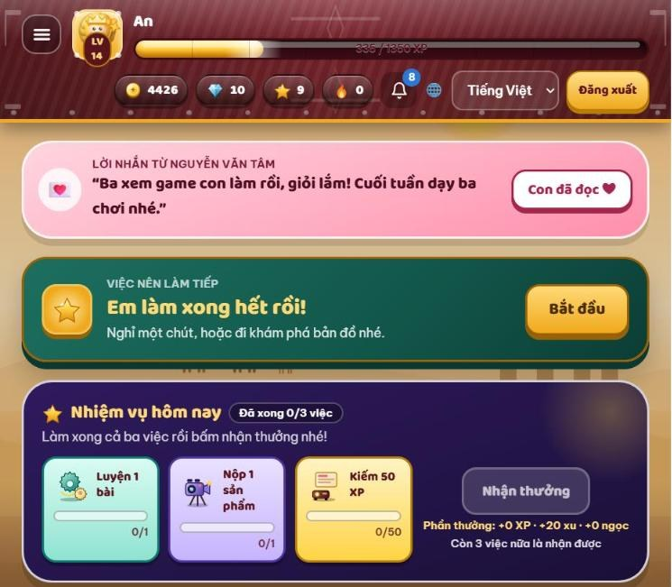

# 3. Tự luyện

> **Cập nhật:** 12/11/2026 · [Về trang tổng quan](hoc-vien/huong-dan-lms.md)

## Bản đồ phiêu lưu

1. Menu **Luyện tập** → **Bản đồ phiêu lưu**. Hành trình là việc chính: bấm **Chơi**, làm nhiệm vụ lần lượt từ trên xuống.
2. Năm thế giới đi theo thứ tự: Quần đảo Khởi đầu → Rừng già → Sa mạc Cát Vàng → Vũ trụ bao la → Thành phố AI. Xong thế giới này mới mở thế giới tiếp theo.
3. Đúng từ 60% là qua màn; mỗi nhiệm vụ được tối đa 3 sao. Xong 10 nhiệm vụ thì mở rương và mở thế giới mới.
4. Mỗi ngày 1–2 nhiệm vụ là vừa. Chơi lại được để lấy đủ 3 sao.

[Mở trên LMS: Luyện tập](https://lmskid.cybersoft.edu.vn/hoc-sinh/luyen-tap)

## Các góc luyện khác

| Góc | Làm gì | Kiểu |
|---|---|---|
| Nhiệm vụ hôm nay (trang Tổng quan) | Ba việc: luyện 1 bài, nộp 1 sản phẩm, kiếm 50 XP. Xong cả ba thì bấm Nhận thưởng. | Mỗi ngày |
| Học viện Tư duy và Công nghệ | Tư duy phản biện, tư duy hệ thống, lập trình, công nghệ và AI | Song song với Hành trình |
| Ôn theo khóa học | Ôn lại bài của khóa đang học | Tùy chọn |
| Xưởng sáng tạo | Tự làm sản phẩm theo ý thích | Tự do |
| Luyện gõ phím | Hành trình 10 Ngón; gõ tiếng Anh, Telex, VNI; thử thách 60 giây | Tự do |
| Bồi dưỡng ngoài giờ | Nhận nhiệm vụ bồi dưỡng thêm ngoài giờ học | Tùy chọn |

---

**Phần tiếp theo:** [4. Thành tích và huy hiệu](hoc-vien/04-thanh-tich.md)
