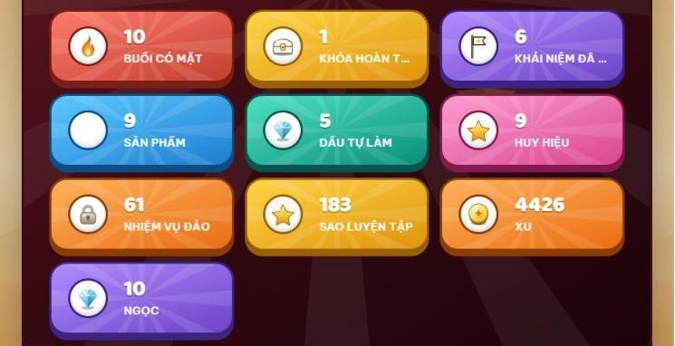
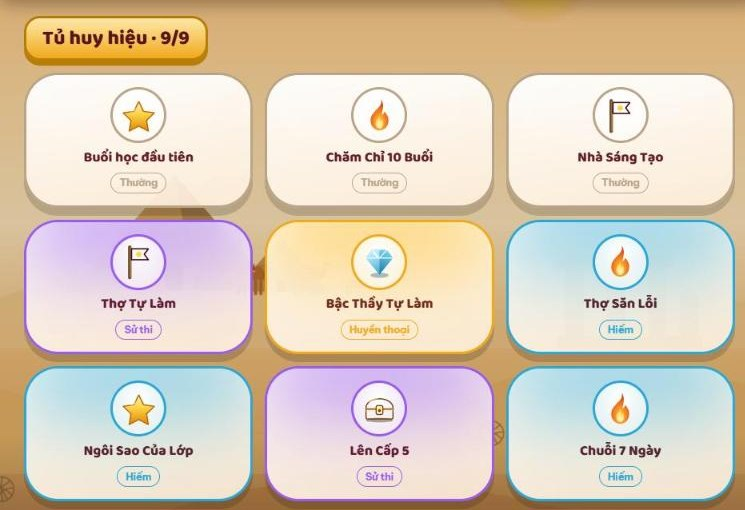

# 4. Thành tích và huy hiệu

> **Cập nhật:** 12/11/2026 · [Về trang tổng quan](hoc-vien/huong-dan-lms.md)

| Thành tích | Có được khi | Dùng để |
|---|---|---|
| XP, Cấp, Hạng | Có mặt đúng giờ, làm nhiệm vụ, luyện tập, nộp bài, được đóng Dấu Tự Làm | Lên cấp, lên hạng |
| Xu | Rương cuối mỗi buổi học, nhiệm vụ hôm nay, qua màn luyện tập, được thầy cô khen | Mua đồ ảo trong Kho đồ (trang phục cho Leo) |
| Ngọc | Dấu Tự Làm, mở huy hiệu hiếm, đồ án, hoàn thành khóa, thi đấu | Đổi quà thật |
| Sao | Tối đa 3 sao mỗi nhiệm vụ luyện tập; bài tập được thầy cô chấm sao | Biết mình làm tốt đến đâu |
| Dấu Tự Làm | Bài đủ ba bằng chứng và do con tự làm | Nhận ngọc, mở huy hiệu Tự Làm |
| Huy hiệu | Đạt các mốc trong bảng dưới | Trưng trong Tủ huy hiệu |
| Sticker | Hoàn thành nhiệm vụ trên các đảo luyện tập | Sưu tầm đủ bộ trong album; sticker trùng bán lấy xu |

Mức thưởng của từng việc hiện ngay trên LMS và có thể được trung tâm điều chỉnh.

[Mở trên LMS: Thành tích](https://lmskid.cybersoft.edu.vn/hoc-sinh/thanh-tich)

## Huy hiệu

| Huy hiệu | Cách nhận | Độ hiếm |
|---|---|---|
| Buổi học đầu tiên | Có mặt buổi học đầu tiên | Thường |
| Chăm Chỉ 10 Buổi | Có mặt 10 buổi | Thường |
| Nhà Sáng Tạo | Nộp 3 sản phẩm hoặc bài tập | Thường |
| Thợ Tự Làm | Nhận Dấu Tự Làm đầu tiên | Sử thi |
| Bậc Thầy Tự Làm | Nhận 5 Dấu Tự Làm | Huyền thoại |
| Thợ Săn Lỗi | Đang cập nhật, xem [trang riêng](hoc-vien/05-tho-san-loi.md) | Hiếm |
| Ngôi Sao Của Lớp | Được thầy cô khen 5 lần | Hiếm |
| Chuỗi 7 Ngày | Học 7 ngày liên tiếp | Hiếm |
| Lên Cấp 5 | Đạt cấp 5 | Sử thi |

[Mở trên LMS: Tủ huy hiệu](https://lmskid.cybersoft.edu.vn/hoc-sinh/thanh-tich/huy-hieu)

## Hồ sơ năng lực và Kho đồ

1. Menu **Thành tích**: hồ sơ năng lực, cấp, hạng, các chỉ số; bấm **In / lưu PDF** để lưu.
2. Hồ sơ để riêng tư. Muốn chia sẻ, ba mẹ bật link công khai; link có hạn dùng và thu hồi được.
3. **Tường cá nhân** ở trang Thành tích: học tốt, luyện nhiều thì các vùng càng rực rỡ; bấm Trang trí để bày biện.
4. Menu **Kho đồ**: dùng xu sắm trang phục cho Leo; xem album sticker.

[Mở trên LMS: Kho đồ](https://lmskid.cybersoft.edu.vn/hoc-sinh/kho-do)

---

**Phần tiếp theo:** [5. Huy hiệu Thợ Săn Lỗi](hoc-vien/05-tho-san-loi.md)
