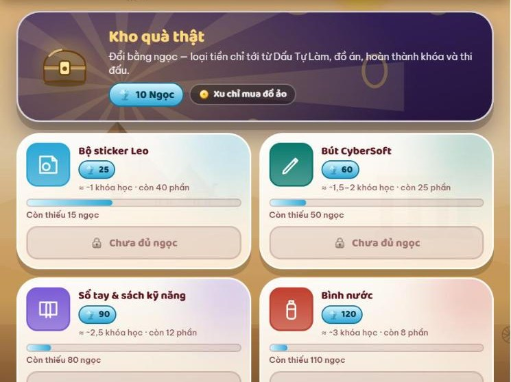

# 6. Đổi quà thật

> **Cập nhật:** 12/11/2026 · [Về trang tổng quan](hoc-vien/huong-dan-lms.md)

1. Kho đồ → **Đổi quà**. Quà thật đổi bằng **ngọc**; xu chỉ mua đồ ảo.
2. Đủ ngọc thì đổi được. Giáo vụ duyệt, con nhận quà tại cơ sở và ký nhận trên app.
3. Mỗi khóa đổi tối đa 1 món quà thật; ngọc còn lại giữ nguyên.
4. Quà lớn trao trước lớp ở buổi Khoe hoặc Demo Day. Đồ trên LMS không bao giờ mua bằng tiền thật.

| Quà | Ngọc | Ước tính |
|---|---|---|
| Bộ sticker Leo | 25 | Khoảng 1 khóa học |
| Bút CyberSoft | 60 | Khoảng 1,5–2 khóa |
| Sổ tay và sách kỹ năng | 90 | Khoảng 2,5 khóa |
| Bình nước | 120 | Khoảng 3 khóa |
| Mũ bảo hiểm | 150 | Khoảng 4 khóa |
| Ba lô | 180 | Khoảng 4,5 khóa |
| Sư tử Leo bông | 220 | Khoảng 5–6 khóa |

Số ngọc của từng món theo Kho quà thật trên LMS tại thời điểm cập nhật.

[Mở trên LMS: Đổi quà](https://lmskid.cybersoft.edu.vn/hoc-sinh/kho-do/doi-qua)

---

**Phần tiếp theo:** [7. Dành cho phụ huynh](hoc-vien/07-phu-huynh.md)
