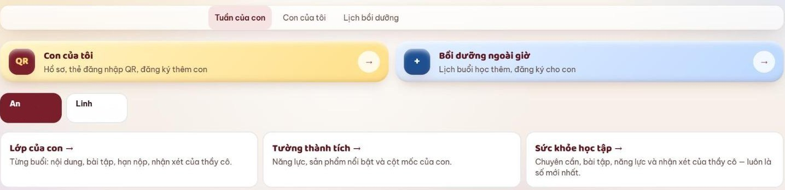
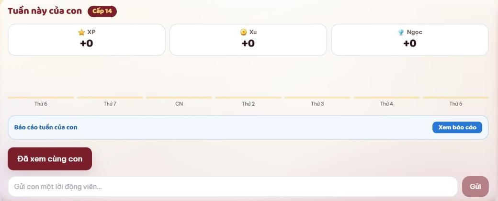
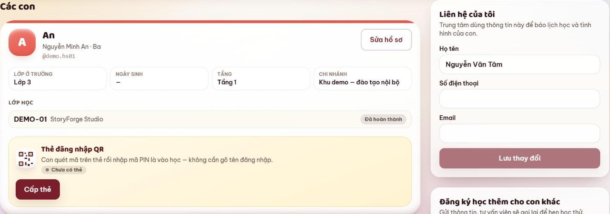
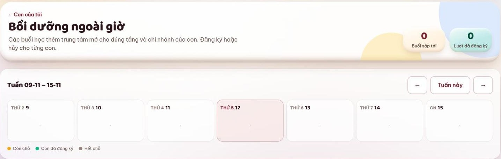

# 7. Dành cho phụ huynh

> **Cập nhật:** 12/11/2026 · [Về trang tổng quan](hoc-vien/huong-dan-lms.md)

Khu phụ huynh có ba mục: **Tuần của con**, **Con của tôi**, **Lịch bồi dưỡng**. Nhà có nhiều con: bấm tên con để xem riêng từng con.

[Mở trên LMS: Khu phụ huynh](https://lmskid.cybersoft.edu.vn/phu-huynh)

## Tuần của con

1. **Tuần này của con:** XP, xu, ngọc con kiếm được trong tuần. Bấm **Xem báo cáo** để xem báo cáo tuần.
2. Gõ vào ô **Gửi con một lời động viên** → **Gửi**: lời nhắn hiện ở trang Tổng quan của con. Xem báo cáo cùng con xong thì bấm **Đã xem cùng con**.
3. Bên dưới: chuyên cần, Dấu Tự Làm, khoảnh khắc của con ở lớp, lời nhận xét của thầy cô, sản phẩm con làm (bấm **Chạy** để chơi thử).
4. **Hộ chiếu năng lực:** 5 năng lực, mức do giáo viên chốt sau mỗi chặng và khóa. Ba nút **Lớp của con**, **Tường thành tích**, **Sức khỏe học tập** mở phần chi tiết.

## Con của tôi

1. Hồ sơ từng con: lớp ở trường, tầng, chi nhánh, lớp đang học; bấm **Sửa hồ sơ** khi cần sửa.
2. **Liên hệ của tôi:** họ tên, số điện thoại, email. Trung tâm dùng thông tin này để báo lịch học và tình hình của con; sửa xong bấm **Lưu thay đổi**.
3. **Hành trình cuối khóa:** khảo sát ngắn ở các mốc của khóa (mỗi câu chấm từ 0 đến 10), dự án cuối khóa của con (bấm **Chơi thử**), chứng chỉ của con.
4. **Đăng ký học thêm cho con khác:** gửi thông tin, tư vấn viên gọi lại để hẹn học thử.

## Nhận xét và Sức khỏe học tập

1. **Sức khỏe học tập:** chuyên cần (7, 30 hoặc 60 ngày qua), năng lực, lịch học bù, nhận xét của thầy cô.
2. Nhận xét có hai loại: tổng quan theo giai đoạn và nhận xét từng buổi học.
3. Nhận xét mỗi buổi có lời động viên (con cũng thấy) và góp ý riêng (chỉ ba mẹ thấy). Thầy cô gửi trên LMS trong 48 giờ sau buổi; nhóm Zalo lớp nhận nhận xét chung của cả lớp.

## Lịch bồi dưỡng

1. Các buổi học thêm trung tâm mở cho đúng tầng và chi nhánh của con.
2. Xem lịch theo tuần: Còn chỗ, Con đã đăng ký, Hết chỗ. Đăng ký hoặc hủy cho từng con.

---

[Về trang tổng quan](hoc-vien/huong-dan-lms.md)
