# HƯỚNG DẪN HỌC VIÊN VÀ PHỤ HUYNH DÙNG LMS JUNIOR

> - **Trang học:** [lmskid.cybersoft.edu.vn](https://lmskid.cybersoft.edu.vn), mở được trên máy tính, máy tính bảng và điện thoại.
> - **Dành cho:** Học viên và phụ huynh CyberSoft Junior.
> - **Cập nhật:** 12/11/2026. Ảnh chụp từ LMS thật, tài khoản demo.

**Nội dung:** 1. Đăng nhập và thẻ QR · 2. Quên mật khẩu, mã PIN, mất thẻ · 3. Học theo buổi · 4. Tự luyện · 5. Thành tích · 6. Đổi quà thật · 7. Dành cho phụ huynh · Khi cần hỗ trợ

---

## 1. Đăng nhập và thẻ QR

### Học viên

1. Mở [lmskid.cybersoft.edu.vn](https://lmskid.cybersoft.edu.vn), chọn tab **Học sinh**.
2. Bước 1: nhập **Mã lớp** thầy cô ghi trên bảng (ví dụ PA-03) → **Tiếp**.
3. Bước 2 “Con là ai?”: nhập **Tên đăng nhập** có trên thẻ (ví dụ hs.012), hoặc gõ họ tên thật → **Tiếp**.
4. Bước 3: bấm **Mã PIN** 4 số → **Vào học thôi!** Có thẻ QR: bấm **Quét thẻ** rồi chỉ cần nhập mã PIN.

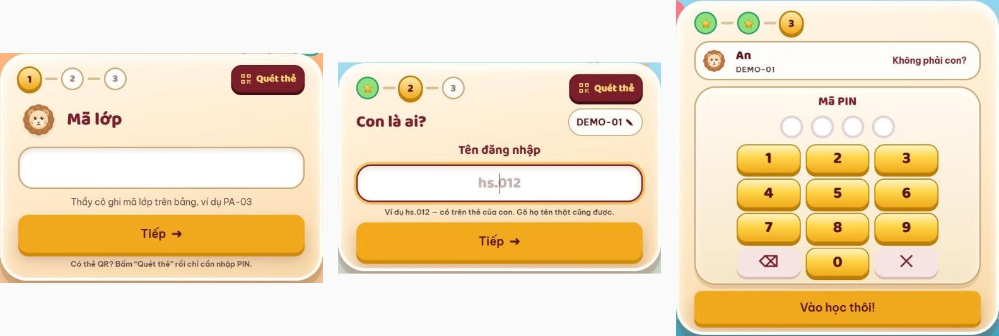

Con có ba cách đăng nhập:

| Cách | Dùng khi |
|---|---|
| Mã lớp + tên đăng nhập + mã PIN (tab Học sinh) | Ở lớp, khi con đã được xếp lớp |
| Thẻ đăng nhập QR + mã PIN | Ở lớp hoặc ở nhà; thẻ thay cho mã lớp và tên đăng nhập |
| Tên đăng nhập + mật khẩu (tab Người lớn) | Ở nhà |

Tên đăng nhập, mật khẩu và mã PIN của con do trung tâm cấp khi nhập học.

### Thẻ đăng nhập QR

1. Khi nhập học, trung tâm in cho phụ huynh thẻ tài khoản (tên đăng nhập, mật khẩu, mã PIN của con) và thẻ QR của con. Con chưa được xếp lớp vẫn dùng thẻ QR để vào tự luyện.
2. Cần thẻ mới: phụ huynh vào **Con của tôi** → **Thẻ đăng nhập QR** → **Cấp thẻ mới**. Mã thẻ chỉ hiện một lần lúc cấp: bấm **In thẻ** hoặc chụp lại ngay, dán vào vở hoặc cặp của con.
3. Con quét mã QR bằng máy tính bảng hoặc điện thoại, rồi nhập mã PIN. Thẻ vẫn cần PIN nên mất thẻ, người khác cũng không vào được.
4. Mất thẻ: bấm **Thu hồi thẻ**, rồi **Cấp thẻ mới**; thẻ cũ hết hiệu lực ngay. Trong lúc chờ, con đăng nhập bằng tên đăng nhập + mật khẩu.

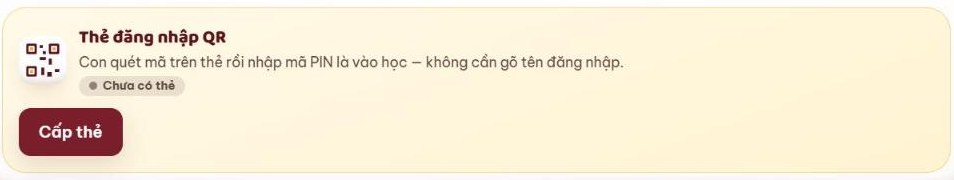

### Phụ huynh

1. Chọn tab **Người lớn** (phụ huynh, thầy cô), nhập Tên đăng nhập và Mật khẩu → **Đăng nhập**.
2. Lần đầu dùng: bấm **Kích hoạt tài khoản**, nhập email hoặc số điện thoại đã đăng ký với trung tâm → **Gửi mã cho tôi**.
3. Nhập mã 6 số: có số điện thoại thì mã gửi qua Zalo, có email thì gửi qua email.
4. Đặt mật khẩu từ 8 ký tự trở lên.

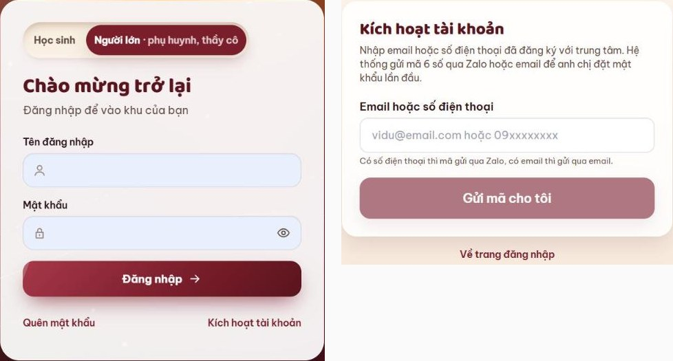

---

## 2. Quên mật khẩu, mã PIN hoặc mất thẻ

| Trường hợp | Cách làm |
|---|---|
| Phụ huynh quên mật khẩu | Bấm **Quên mật khẩu** ở tab Người lớn → nhập email hoặc số điện thoại của tài khoản → **Gửi mã cho tôi** → nhập mã 6 số → đặt mật khẩu mới. |
| Không nhận được mã 6 số, hoặc đã đổi email, số điện thoại | Báo Giáo viên hoặc Giáo vụ của lớp để cập nhật thông tin. |
| Học viên quên mã lớp hoặc tên đăng nhập | Báo Giáo viên hoặc Giáo vụ để được nhắc lại. |
| Học viên quên mã PIN | Đăng nhập bằng tên đăng nhập + mật khẩu (tab Người lớn). |
| Học viên quên mật khẩu | Đăng nhập bằng mã lớp + mã PIN, hoặc thẻ QR + mã PIN. |
| Học viên mất thẻ đăng nhập | Phụ huynh vào Con của tôi → **Thu hồi thẻ** → **Cấp thẻ mới**. Không tự làm được thì báo Giáo viên hoặc Giáo vụ; Giáo vụ thu hồi thẻ cũ và cấp thẻ mới. |

Giữ kín mật khẩu, mã PIN; không đưa thẻ đăng nhập cho người khác.

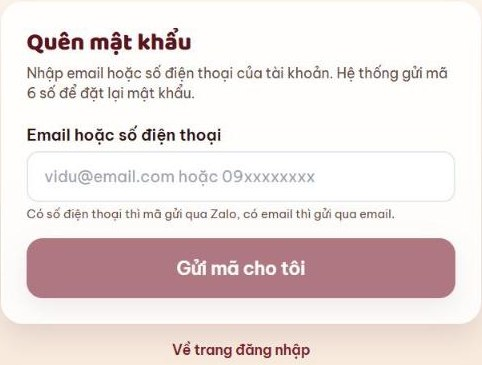

---

## 3. Học theo buổi

### Lớp học và lộ trình

1. Menu **Lớp học** → chọn lớp: xem chuyên cần, số bài đã nộp, bài khởi động, sản phẩm.
2. **Lộ trình các buổi**: buổi đã học có dấu tích, kèm trạng thái có mặt, số sao và bài tập.
3. Bấm một buổi để mở trang của buổi đó.
4. Lớp đã kết thúc: xem lại được mọi nội dung, không nộp bài nữa.

[Mở trên LMS: Lớp học](https://lmskid.cybersoft.edu.vn/hoc-sinh/lop)

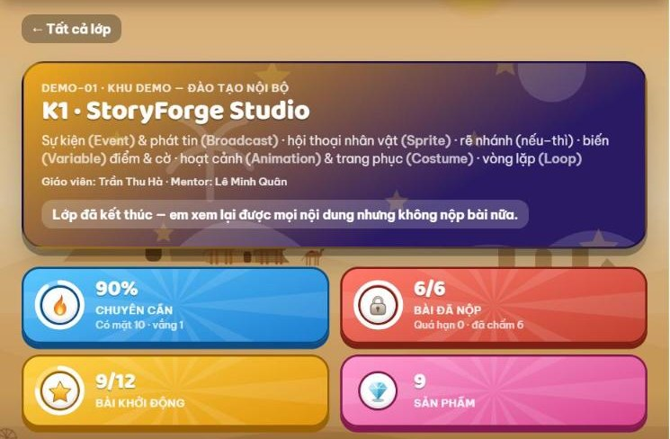

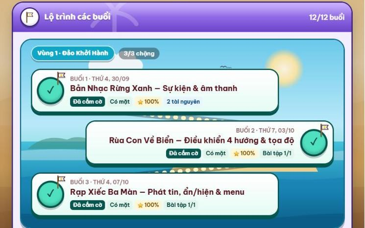

### Trong một buổi

1. **Trước buổi:** làm **Khởi động của buổi**.
2. **Trong buổi:** học theo **Tài liệu** và mục tiêu buổi học.
3. **Sau buổi:** mở **Bài tập của buổi** ở trang buổi học. Bấm **Mở Scratch để làm**, làm xong bấm **Lưu nháp**; quay lại trang buổi, chọn sản phẩm vừa lưu ở ô **Sản phẩm của em**, điền clip giải thích (link YouTube), bản nháp ý tưởng, nhật ký dùng AI rồi bấm **Nộp bài**. Hạn nộp ghi ở từng bài; nộp lại được.
4. Thầy cô chấm sao và nhận xét, con xem ngay trong bài. Bài đủ ba bằng chứng (bản nháp ý tưởng, nhật ký dùng AI, clip giải thích) và do con tự làm được xét **Dấu Tự Làm**.

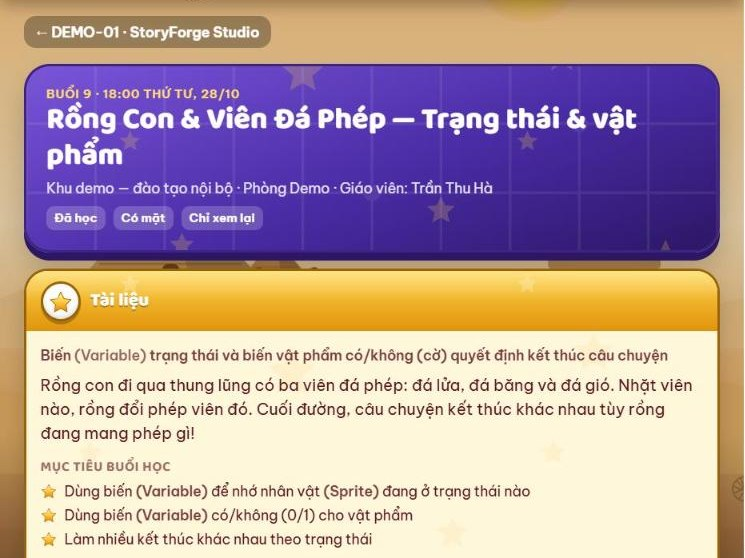

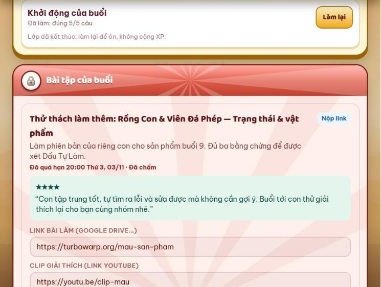

### Dự án cuối khóa

| Mốc | Buổi (khóa 12 buổi) | Nộp |
|---|---|---|
| 1. Ý tưởng | Buổi 9 | Dán link trên trang lớp |
| 2. Bản nháp chạy thử | Buổi 11 | Link chơi thử (TurboWarp, Scratch hoặc trang web) |
| 3. Final Demo | Buổi 12 | Link chơi thử bản hoàn chỉnh |

Đủ điều kiện nhận chứng chỉ: chuyên cần từ 70% và đã nộp mốc dự án cuối.

---

## 4. Tự luyện

### Bản đồ phiêu lưu

1. Menu **Luyện tập** → **Bản đồ phiêu lưu**. Hành trình là việc chính: bấm **Chơi**, làm nhiệm vụ lần lượt từ trên xuống.
2. Năm thế giới đi theo thứ tự: Quần đảo Khởi đầu → Rừng già → Sa mạc Cát Vàng → Vũ trụ bao la → Thành phố AI. Xong thế giới này mới mở thế giới tiếp theo.
3. Đúng từ 60% là qua màn; mỗi nhiệm vụ được tối đa 3 sao. Xong 10 nhiệm vụ thì mở rương và mở thế giới mới.
4. Mỗi ngày 1–2 nhiệm vụ là vừa. Chơi lại được để lấy đủ 3 sao.

[Mở trên LMS: Luyện tập](https://lmskid.cybersoft.edu.vn/hoc-sinh/luyen-tap)

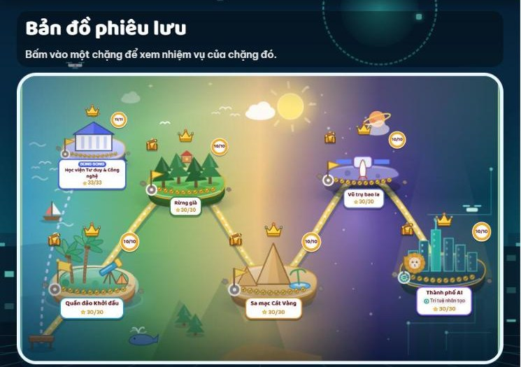

### Các góc luyện khác

| Góc | Làm gì | Kiểu |
|---|---|---|
| Nhiệm vụ hôm nay (trang Tổng quan) | Ba việc: luyện 1 bài, nộp 1 sản phẩm, kiếm 50 XP. Xong cả ba thì bấm Nhận thưởng. | Mỗi ngày |
| Học viện Tư duy và Công nghệ | Tư duy phản biện, tư duy hệ thống, lập trình, công nghệ và AI | Song song với Hành trình |
| Ôn theo khóa học | Ôn lại bài của khóa đang học | Tùy chọn |
| Xưởng sáng tạo | Tự làm sản phẩm theo ý thích | Tự do |
| Luyện gõ phím | Hành trình 10 Ngón; gõ tiếng Anh, Telex, VNI; thử thách 60 giây | Tự do |
| Bồi dưỡng ngoài giờ | Nhận nhiệm vụ bồi dưỡng thêm ngoài giờ học | Tùy chọn |

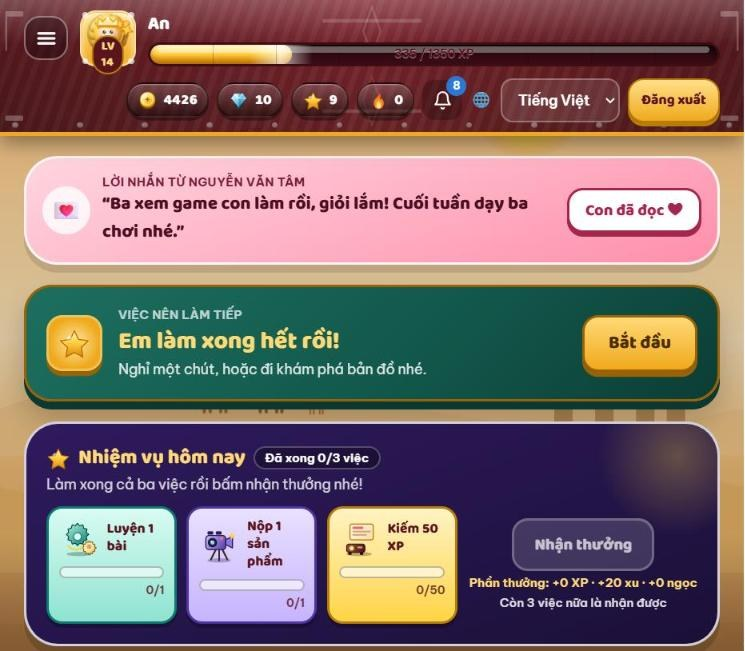

---

## 5. Thành tích

| Thành tích | Có được khi | Dùng để |
|---|---|---|
| XP, Cấp, Hạng | Có mặt đúng giờ, làm nhiệm vụ, luyện tập, nộp bài, được đóng Dấu Tự Làm | Lên cấp, lên hạng |
| Xu | Rương cuối mỗi buổi học, nhiệm vụ hôm nay, qua màn luyện tập, được thầy cô khen | Mua đồ ảo trong Kho đồ (trang phục cho Leo) |
| Ngọc | Dấu Tự Làm, mở huy hiệu hiếm, đồ án, hoàn thành khóa, thi đấu | Đổi quà thật |
| Sao | Tối đa 3 sao mỗi nhiệm vụ luyện tập; bài tập được thầy cô chấm sao | Biết mình làm tốt đến đâu |
| Dấu Tự Làm | Bài đủ ba bằng chứng và do con tự làm | Nhận ngọc, mở huy hiệu Tự Làm |
| Huy hiệu | Đạt các mốc trong bảng dưới | Trưng trong Tủ huy hiệu |
| Sticker | Hoàn thành nhiệm vụ trên các đảo luyện tập | Sưu tầm đủ bộ trong album; sticker trùng bán lấy xu |

Mức thưởng của từng việc hiện ngay trên LMS và có thể được trung tâm điều chỉnh.

[Mở trên LMS: Thành tích](https://lmskid.cybersoft.edu.vn/hoc-sinh/thanh-tich)

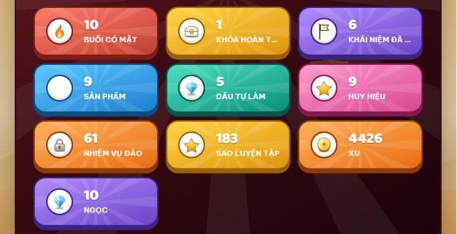

### Huy hiệu

| Huy hiệu | Cách nhận | Độ hiếm |
|---|---|---|
| Buổi học đầu tiên | Có mặt buổi học đầu tiên | Thường |
| Chăm Chỉ 10 Buổi | Có mặt 10 buổi | Thường |
| Nhà Sáng Tạo | Nộp 3 sản phẩm hoặc bài tập | Thường |
| Thợ Tự Làm | Nhận Dấu Tự Làm đầu tiên | Sử thi |
| Bậc Thầy Tự Làm | Nhận 5 Dấu Tự Làm | Huyền thoại |
| Thợ Săn Lỗi | Đủ 10 lần săn lỗi | Hiếm |
| Ngôi Sao Của Lớp | Được thầy cô khen 5 lần | Hiếm |
| Chuỗi 7 Ngày | Học 7 ngày liên tiếp | Hiếm |
| Lên Cấp 5 | Đạt cấp 5 | Sử thi |

[Mở trên LMS: Tủ huy hiệu](https://lmskid.cybersoft.edu.vn/hoc-sinh/thanh-tich/huy-hieu)

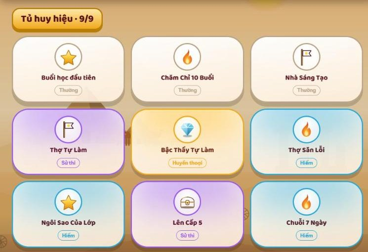

### Hồ sơ năng lực và Kho đồ

1. Menu **Thành tích**: hồ sơ năng lực, cấp, hạng, các chỉ số; bấm **In / lưu PDF** để lưu.
2. Hồ sơ để riêng tư. Muốn chia sẻ, ba mẹ bật link công khai; link có hạn dùng và thu hồi được.
3. **Tường cá nhân** ở trang Thành tích: học tốt, luyện nhiều thì các vùng càng rực rỡ; bấm Trang trí để bày biện.
4. Menu **Kho đồ**: dùng xu sắm trang phục cho Leo; xem album sticker.

[Mở trên LMS: Kho đồ](https://lmskid.cybersoft.edu.vn/hoc-sinh/kho-do)

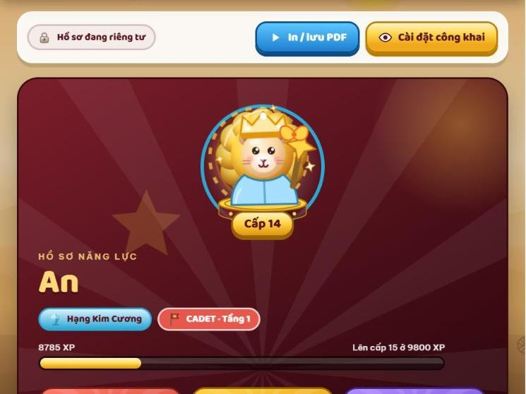

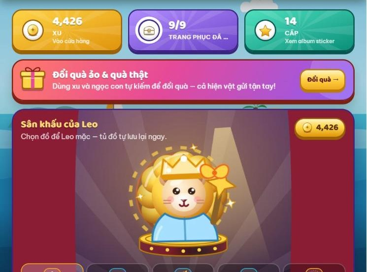

---

## 6. Đổi quà thật

1. Kho đồ → **Đổi quà**. Quà thật đổi bằng **ngọc**; xu chỉ mua đồ ảo.
2. Đủ ngọc thì đổi được. Giáo vụ duyệt, con nhận quà tại cơ sở và ký nhận trên app.
3. Mỗi khóa đổi tối đa 1 món quà thật; ngọc còn lại giữ nguyên.
4. Quà lớn trao trước lớp ở buổi Khoe hoặc Demo Day. Đồ trên LMS không bao giờ mua bằng tiền thật.

| Quà | Ngọc | Ước tính |
|---|---|---|
| Bộ sticker Leo | 25 | Khoảng 1 khóa học |
| Bút CyberSoft | 60 | Khoảng 1,5–2 khóa |
| Sổ tay và sách kỹ năng | 90 | Khoảng 2,5 khóa |
| Bình nước | 120 | Khoảng 3 khóa |
| Mũ bảo hiểm | 150 | Khoảng 4 khóa |
| Ba lô | 180 | Khoảng 4,5 khóa |
| Sư tử Leo bông | 220 | Khoảng 5–6 khóa |

Số ngọc của từng món theo Kho quà thật trên LMS tại thời điểm cập nhật.

[Mở trên LMS: Đổi quà](https://lmskid.cybersoft.edu.vn/hoc-sinh/kho-do/doi-qua)

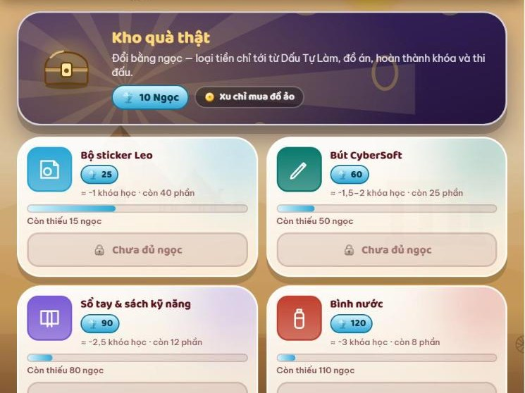

---

## 7. Dành cho phụ huynh

Khu phụ huynh có ba mục: **Tuần của con**, **Con của tôi**, **Lịch bồi dưỡng**. Nhà có nhiều con: bấm tên con để xem riêng từng con.

[Mở trên LMS: Khu phụ huynh](https://lmskid.cybersoft.edu.vn/phu-huynh)

### Tuần của con

1. **Tuần này của con:** XP, xu, ngọc con kiếm được trong tuần. Bấm **Xem báo cáo** để xem báo cáo tuần.
2. Gõ vào ô **Gửi con một lời động viên** → **Gửi**: lời nhắn hiện ở trang Tổng quan của con. Xem báo cáo cùng con xong thì bấm **Đã xem cùng con**.
3. Bên dưới: chuyên cần, Dấu Tự Làm, khoảnh khắc của con ở lớp, lời nhận xét của thầy cô, sản phẩm con làm (bấm **Chạy** để chơi thử).
4. **Hộ chiếu năng lực:** 5 năng lực, mức do giáo viên chốt sau mỗi chặng và khóa. Ba nút **Lớp của con**, **Tường thành tích**, **Sức khỏe học tập** mở phần chi tiết.

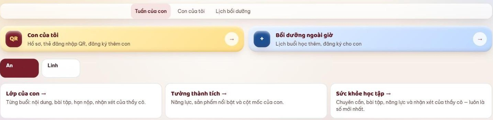

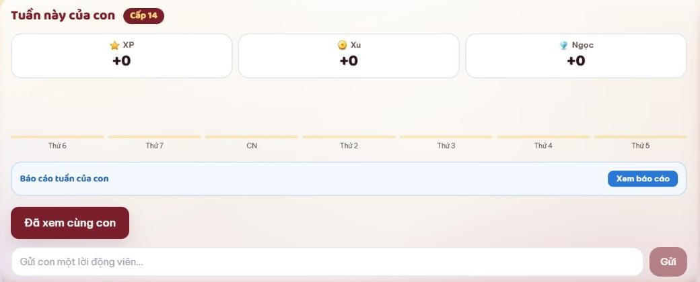

### Con của tôi

1. Hồ sơ từng con: lớp ở trường, tầng, chi nhánh, lớp đang học; bấm **Sửa hồ sơ** khi cần sửa.
2. **Liên hệ của tôi:** họ tên, số điện thoại, email. Trung tâm dùng thông tin này để báo lịch học và tình hình của con; sửa xong bấm **Lưu thay đổi**.
3. **Hành trình cuối khóa:** khảo sát ngắn ở các mốc của khóa (mỗi câu chấm từ 0 đến 10), dự án cuối khóa của con (bấm **Chơi thử**), chứng chỉ của con.
4. **Đăng ký học thêm cho con khác:** gửi thông tin, tư vấn viên gọi lại để hẹn học thử.

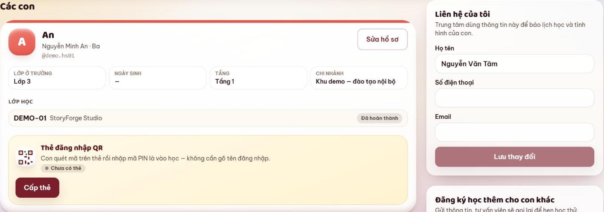

### Nhận xét và Sức khỏe học tập

1. **Sức khỏe học tập:** chuyên cần (7, 30 hoặc 60 ngày qua), năng lực, lịch học bù, nhận xét của thầy cô.
2. Nhận xét có hai loại: tổng quan theo giai đoạn và nhận xét từng buổi học.
3. Nhận xét mỗi buổi có lời động viên (con cũng thấy) và góp ý riêng (chỉ ba mẹ thấy). Thầy cô gửi trên LMS trong 48 giờ sau buổi; nhóm Zalo lớp nhận nhận xét chung của cả lớp.

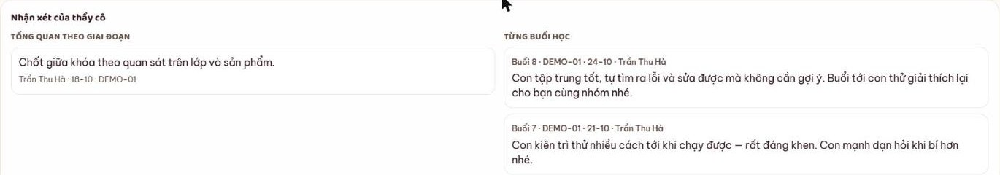

### Lịch bồi dưỡng

1. Các buổi học thêm trung tâm mở cho đúng tầng và chi nhánh của con.
2. Xem lịch theo tuần: Còn chỗ, Con đã đăng ký, Hết chỗ. Đăng ký hoặc hủy cho từng con.

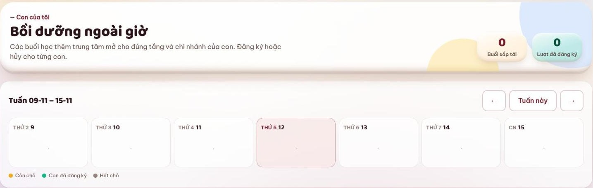

---

## Khi cần hỗ trợ

- Liên hệ Giáo viên hoặc Giáo vụ của lớp qua nhóm Zalo lớp hoặc tại cơ sở.
- Chuông thông báo ở góc trên: tin mới từ lớp.
- Đổi ngôn ngữ hiển thị (Tiếng Việt, English, 日本語) ở góc trên.
